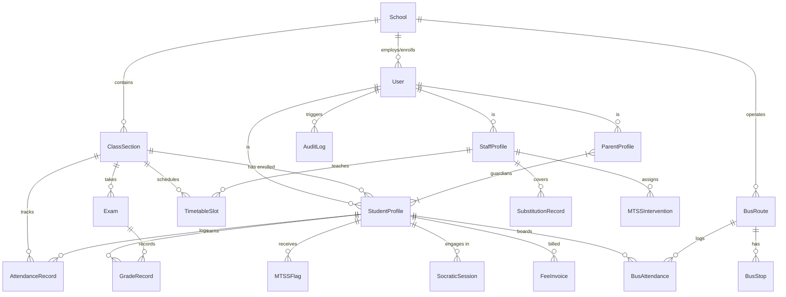

# Architecture & System Design Document
## Project: Aetheris School OS
**High-Performance Monorepo Architecture for K-12 Institutional Management & Intelligence**

---

## 1. System Topology & Monorepo Structure

Aetheris School OS is architected as an ultra-responsive, type-safe full-stack application structured within a high-performance monorepo. It adheres to modern clean architecture principles, separating the reactive client application from core business domain logic and persistence layers.

```
f_s_2/
├── apps/
│   ├── web/                     # Next.js 15 (App Router) client & SSR application
│   │   ├── app/                 # App Router pages (Role dashboards, Command Bar, etc.)
│   │   ├── components/          # Design system components, role-specific views
│   │   ├── hooks/               # Custom React hooks (auth, translation, command palette)
│   │   └── lib/                 # Client utilities, API client, state
│   └── api/                     # Node.js / Express or Next.js route handlers backend
│       ├── controllers/         # Domain controllers (MTSS, Socratic, Substitution, etc.)
│       ├── services/            # Business logic & AI orchestration
│       └── middleware/          # JWT Auth, RBAC, Rate-limiting, Audit logging
├── packages/
│   ├── shared/                  # Common TypeScript interfaces, DTOs, schemas (Zod)
│   └── database/                # Prisma ORM schema, migrations, and seed scripts
├── docs/                        # PRD, Architecture, Design System
└── research/                    # Market gap reports and competitive research
```

---

## 2. Technology Stack Selection & Rationale

| Layer | Selected Technology | Technical Rationale |
| :--- | :--- | :--- |
| **Frontend Framework** | **Next.js 15 (App Router) + TypeScript** | Server Components for instant initial paint, Client Components for rich micro-interactions, streaming SSR, and edge-ready API routes. |
| **Styling & Design System** | **Tailwind CSS + shadcn/ui + Framer Motion** | Tokenized design system matching Linear/Notion standards; zero-runtime CSS; fluid spring physics animations; fully accessible Radix UI primitives. |
| **State Management** | **Zustand + TanStack Query (React Query)** | Optimistic UI updates for attendance and grade entry, automatic cache invalidation, and minimal boilerplate. |
| **Backend & API Layer** | **Next.js API Routes / Node.js + tRPC / REST** | Unified type safety end-to-end from database models to frontend components with strict runtime Zod validation. |
| **Database & ORM** | **PostgreSQL + Prisma ORM** | Relational integrity for complex foreign key relationships (classes, grades, attendance, fees); Prisma client provides compile-time query safety. |
| **Caching & Real-Time Sync** | **Redis (or in-memory cache fallback)** | Fast session management, rate-limiting, and real-time transit bus coordinate caching. |
| **AI Orchestration** | **OpenRouter API (Gemini / Claude / Llama models)** | High-reliability LLM routing for the Socratic AI Tutor, AI Report Card remarks, and smart notification triage. |
| **Internationalization** | **next-intl / Custom Trilingual Engine** | Dynamic localized string switching (English, Hindi, Kannada) with zero page reload. |

---

## 3. Database Schema & Entity-Relationship Architecture

The relational schema is designed for multi-tenant scalability, strong referential integrity, and rigorous auditability.



### Key Prisma Entity Definitions

```prisma
datasource db {
  provider = "postgresql"
  url      = env("DATABASE_URL")
}

generator client {
  provider = "prisma-client-js"
}

enum Role {
  ADMIN
  PRINCIPAL
  TEACHER
  STUDENT
  PARENT
  ACCOUNTANT
  TRANSPORT
}

enum AttendanceStatus {
  PRESENT
  ABSENT
  LATE
  EXCUSED
}

enum MTSSSeverity {
  TIER_1_LOW
  TIER_2_MODERATE
  TIER_3_CRITICAL
}

enum InvoiceStatus {
  PENDING
  PARTIAL
  PAID
  OVERDUE
  INSTALLMENT_REQUESTED
}

model School {
  id          String   @id @default(cuid())
  name        String
  code        String   @unique
  address     String
  curriculum  String   // CBSE, ICSE, IB, State
  createdAt   DateTime @default(now())
  users       User[]
  classes     ClassSection[]
  busRoutes   BusRoute[]
  notices     Notice[]
}

model User {
  id            String    @id @default(cuid())
  schoolId      String
  school        School    @relation(fields: [schoolId], references: [id])
  email         String    @unique
  passwordHash  String
  name          String
  role          Role
  phone         String?
  avatarUrl     String?
  languagePref  String    @default("en") // en, hi, kn
  isActive      Boolean   @default(true)
  createdAt     DateTime  @default(now())
  updatedAt     DateTime  @updatedAt

  studentProfile StudentProfile?
  staffProfile   StaffProfile?
  parentProfile  ParentProfile?
  auditLogs      AuditLog[]
}

model StudentProfile {
  id              String         @id @default(cuid())
  userId          String         @unique
  user            User           @relation(fields: [userId], references: [id], onDelete: Cascade)
  admissionNumber String         @unique
  rollNumber      String
  dateOfBirth     DateTime
  gender          String
  bloodGroup      String?
  classSectionId  String
  classSection    ClassSection   @relation(fields: [classSectionId], references: [id])
  guardianId      String?
  guardian        ParentProfile? @relation(fields: [guardianId], references: [id])
  busRouteId      String?
  busRoute        BusRoute?      @relation(fields: [busRouteId], references: [id])
  busStopId       String?
  busStop         BusStop?       @relation(fields: [busStopId], references: [id])
  
  // Intelligence & Learning Vectors
  holisticGrowthIndex Float      @default(85.0)
  
  attendanceRecords  AttendanceRecord[]
  grades             GradeRecord[]
  mtssFlags          MTSSFlag[]
  socraticSessions   SocraticSession[]
  feeInvoices        FeeInvoice[]
  busBoardingLogs    BusAttendance[]
  selMoodLogs        SELMoodLog[]
}

model StaffProfile {
  id              String         @id @default(cuid())
  userId          String         @unique
  user            User           @relation(fields: [userId], references: [id], onDelete: Cascade)
  employeeCode    String         @unique
  designation     String
  department      String
  specializations String[]
  maxWeeklyHours  Int            @default(30)
  currentHours    Int            @default(0)
  
  timetables      TimetableSlot[]
  substitutions   SubstitutionRecord[]
  mtssActions     MTSSIntervention[]
}

model ParentProfile {
  id              String           @id @default(cuid())
  userId          String           @unique
  user            User             @relation(fields: [userId], references: [id], onDelete: Cascade)
  occupation      String?
  students        StudentProfile[]
}

model ClassSection {
  id          String   @id @default(cuid())
  schoolId    String
  school      School   @relation(fields: [schoolId], references: [id])
  gradeLevel  Int      // e.g. 9
  sectionName String   // e.g. "A"
  roomNumber  String
  academicYear String  // e.g. "2026-2027"

  students    StudentProfile[]
  timetable   TimetableSlot[]
  attendance  AttendanceRecord[]
  exams       Exam[]
}

model TimetableSlot {
  id             String       @id @default(cuid())
  classSectionId String
  classSection   ClassSection @relation(fields: [classSectionId], references: [id])
  staffId        String
  staff          StaffProfile @relation(fields: [staffId], references: [id])
  subject        String
  dayOfWeek      Int          // 1 = Monday, 5 = Friday
  periodNumber   Int          // 1 through 8
  startTime      String       // "08:30"
  endTime        String       // "09:15"
}

model AttendanceRecord {
  id             String           @id @default(cuid())
  date           DateTime         @db.Date
  classSectionId String
  classSection   ClassSection     @relation(fields: [classSectionId], references: [id])
  studentId      String
  student        StudentProfile   @relation(fields: [studentId], references: [id])
  periodNumber   Int?             // null for full day, 1-8 for period
  status         AttendanceStatus @default(PRESENT)
  markedById     String
  remarks        String?
  createdAt      DateTime         @default(now())

  @@unique([date, studentId, periodNumber])
}

model Exam {
  id             String       @id @default(cuid())
  classSectionId String
  classSection   ClassSection @relation(fields: [classSectionId], references: [id])
  title          String       // "Midterm Examination"
  subject        String
  maxMarks       Float        @default(100)
  date           DateTime
  term           String

  grades         GradeRecord[]
}

model GradeRecord {
  id             String         @id @default(cuid())
  examId         String
  exam           Exam           @relation(fields: [examId], references: [id])
  studentId      String
  student        StudentProfile @relation(fields: [studentId], references: [id])
  marksObtained  Float
  letterGrade    String?
  teacherRemarks String?
  aiRemarkDraft  String?
  createdAt      DateTime       @default(now())

  @@unique([examId, studentId])
}

// ── Signature Innovation Entities ──

model MTSSFlag {
  id             String         @id @default(cuid())
  studentId      String
  student        StudentProfile @relation(fields: [studentId], references: [id])
  severity       MTSSSeverity
  domain         String         // "ACADEMIC", "ATTENDANCE", "SEL"
  triggerReason  String         // e.g. "Deceleration in Algebra formative scores (-18%) over 3 weeks"
  status         String         // "ACTIVE", "IN_INTERVENTION", "RESOLVED"
  recommendedAction String
  createdAt      DateTime       @default(now())
  interventions  MTSSIntervention[]
}

model MTSSIntervention {
  id             String       @id @default(cuid())
  flagId         String
  flag           MTSSFlag     @relation(fields: [flagId], references: [id])
  assignedToStaffId String
  staff          StaffProfile @relation(fields: [assignedToStaffId], references: [id])
  strategy       String       // e.g. "Assign Chapter 4 Socratic Remediation + 1:1 Check-in"
  progressNotes  String?
  outcomeStatus  String       @default("IN_PROGRESS")
  updatedAt      DateTime     @updatedAt
}

model SocraticSession {
  id             String         @id @default(cuid())
  studentId      String
  student        StudentProfile @relation(fields: [studentId], references: [id])
  subject        String
  topic          String         // e.g. "Factorization of Polynomials"
  messages       Json           // [{ role: "user" | "assistant", content: string, timestamp: string }]
  masteryScore   Float?         // 0 - 100 calculated by diagnostic assessment
  conceptGaps    String[]
  createdAt      DateTime       @default(now())
}

model SubstitutionRecord {
  id             String       @id @default(cuid())
  date           DateTime     @db.Date
  slotId         String
  originalStaffId String
  substituteStaffId String
  substituteStaff StaffProfile @relation(fields: [substituteStaffId], references: [id])
  status         String       // "AUTO_RECOMMENDED", "CONFIRMED", "COMPLETED"
  matchingScore  Float        // Algorithm confidence score (0-100)
  createdAt      DateTime     @default(now())
}

model BusRoute {
  id             String           @id @default(cuid())
  schoolId       String
  school         School           @relation(fields: [schoolId], references: [id])
  routeNumber    String           // "Route 4"
  driverName     String
  driverPhone    String
  attendantName  String
  vehicleNumber  String           // "KA-01-AB-1234"
  currentLat     Float?
  currentLng     Float?
  lastPing       DateTime?
  status         String           @default("IDLE") // "IDLE", "IN_TRANSIT", "COMPLETED"
  
  stops          BusStop[]
  students       StudentProfile[]
  boardingLogs   BusAttendance[]
}

model BusStop {
  id             String           @id @default(cuid())
  routeId        String
  route          BusRoute         @relation(fields: [routeId], references: [id])
  stopName       String
  sequenceOrder  Int
  scheduledTime  String           // "07:35 AM"
  lat            Float
  lng            Float
  students       StudentProfile[]
}

model BusAttendance {
  id             String         @id @default(cuid())
  date           DateTime       @db.Date
  busRouteId     String
  busRoute       BusRoute       @relation(fields: [busRouteId], references: [id])
  studentId      String
  student        StudentProfile @relation(fields: [studentId], references: [id])
  tripType       String         // "MORNING_PICKUP", "AFTERNOON_DROPOFF"
  boardedAt      DateTime       @default(now())
  verifiedBy     String         // "ATTENDANT_SCAN", "MANUAL_TAP"
}

model FeeInvoice {
  id             String         @id @default(cuid())
  studentId      String
  student        StudentProfile @relation(fields: [studentId], references: [id])
  invoiceNumber  String         @unique
  totalAmount    Float
  paidAmount     Float          @default(0.0)
  dueDate        DateTime
  status         InvoiceStatus  @default(PENDING)
  breakdown      Json           // [{ title: "Tuition", amount: 15000 }, { title: "Transport", amount: 4000 }]
  createdAt      DateTime       @default(now())
}

model SELMoodLog {
  id             String         @id @default(cuid())
  studentId      String
  student        StudentProfile @relation(fields: [studentId], references: [id])
  date           DateTime       @db.Date
  moodScore      Int            // 1 to 5 (Sad, Anxious, Neutral, Good, Great)
  energyLevel    Int            // 1 to 3 (Low, Medium, High)
  note           String?
  createdAt      DateTime       @default(now())

  @@unique([date, studentId])
}

model Notice {
  id             String         @id @default(cuid())
  schoolId       String
  school         School         @relation(fields: [schoolId], references: [id])
  title          String
  content        String
  translations   Json           // { en: "...", hi: "...", kn: "..." }
  category       String         // "CRITICAL", "ACADEMIC", "GENERAL"
  targetRole     Role?          // null for all
  targetGrade    Int?           // null for all
  authorName     String
  publishedAt    DateTime       @default(now())
}

model AuditLog {
  id          String   @id @default(cuid())
  userId      String?
  user        User?    @relation(fields: [userId], references: [id])
  action      String   // "GRADE_MODIFIED", "ATTENDANCE_OVERRIDE", "FEE_PAID"
  entityType  String
  entityId    String
  metadata    Json?
  ipAddress   String?
  timestamp   DateTime @default(now())
}
```

---

## 4. Authentication, Authorization & Role-Based Access Control (RBAC)

Aetheris enforces a zero-trust, role-based boundary across all endpoints:

| Role | Access Permissions & Scopes |
| :--- | :--- |
| **ADMIN** | Full institutional governance: system settings, user lifecycle, fee templates, school configuration, compliance audits. |
| **PRINCIPAL** | Read/write institutional telemetry: campus-wide MTSS dashboards, teacher workload balancer, substitute authorization, high-level financials, school circulars. |
| **TEACHER** | Instructional cockpit: assigned classes, period attendance, mark entry, Socratic diagnostic summaries, MTSS Tier 1/2 actions, student remarks. |
| **STUDENT** | Learning workspace: personal schedule, assignments, Socratic AI Tutor, grade trends, transport tracker, library checkout, daily SEL pulse. |
| **PARENT** | Child progress hub: dual-child toggle, attendance logs, verified bus transit notifications, fee settlement, trilingual announcements. |
| **ACCOUNTANT** | Financial management: fee invoicing, installment plan approval, payment gateway reconciliation, expense & ledger reporting. |
| **TRANSPORT** | Fleet operations: live route manifest, student QR/tap boarding check-in, route incident alerting, bus inspection checklist. |

### Minor Data Protection & Privacy Guardrails
1. **COPPA / FERPA / DPDP Segregation:** Student counseling notes, psychiatric flags, and financial hardship requests are cryptographically partitioned; they are strictly never exposed via standard gradebook or student portal APIs.
2. **Opt-in SEL Check-ins:** The daily social-emotional pulse check is strictly non-punitive, opt-in, and uses aggregated sentiment signals rather than intrusive screen or keystroke tracking.
3. **No Direct Model Training on PII:** All LLM prompts routed via OpenRouter strip personal identifiers (names, admission IDs, emails) using local token anonymizers (`Student_A`, `Grade_9`).

---

## 5. API Design & Signature Service Contracts

The system exposes clean, RESTful and type-safe JSON API endpoints:

### Core Administrative Routes:
- `POST /api/auth/login` – Session issuance & role claims.
- `GET /api/students` – Filtered student directory with pagination & search.
- `POST /api/attendance/bulk` – High-velocity attendance batch submission with optimistic UI acknowledgment.
- `GET /api/timetable/matrix` – Weekly schedule grid for class sections and instructors.
- `POST /api/exams/:id/grades` – Bulk marks entry with validation against maximum possible marks.
- `GET /api/fees/invoices` – Invoice status tracking and online payment dispatch.

### Signature Innovation Routes:
- `POST /api/ai/socratic-tutor` – Real-time streaming conversational endpoint. Receives student query + active syllabus context; returns guided Socratic prompts and extracts skill gaps.
- `GET /api/mtss/early-warning` – Computes multi-factor Holistic Growth Index; returns actionable intervention cards categorized by Tier.
- `POST /api/operations/smart-substitute` – Evaluates teacher absence, computes constraint satisfaction matrix (free periods, subject match, weekly load balance), and dispatches proxy allocation.
- `POST /api/transport/board-manifest` – Dual-verification tap endpoint logging student boarding timestamp and sending instant push notification to guardian.
- `POST /api/communication/translate` – Translates notices and teacher remarks into Hindi, Kannada, and English with educational context awareness.
